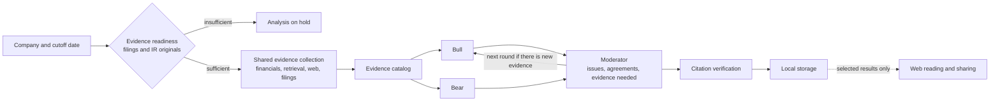

<p align="right"><a href="README.md">한국어</a> | <strong>English</strong></p>

<div align="center">

# MarketCouncil

### Compare competing investment hypotheses against shared evidence.

Bull and Bear debate from the same material, and a Moderator records the open questions and the evidence still needed.<br>
It does not issue buy or sell signals. It shows where judgments diverge and what to check next.

[Website](https://frontend-six-pi-h5i7tztups.vercel.app/?lang=en) · [Research library](https://frontend-six-pi-h5i7tztups.vercel.app/app?lang=en) · [Windows download](https://frontend-six-pi-h5i7tztups.vercel.app/download?lang=en) · [How it works](docs/how-it-works.md#architecture-and-principles) · [Roadmap](docs/ROADMAP.md)

[](https://github.com/woosukkk/MarketCouncil/actions/workflows/ci.yml)

`Python` · `LangGraph` · `ChromaDB / BGE-M3` · `SearXNG` · `React` · `Supabase` · `Vercel`

</div>

[](https://frontend-six-pi-h5i7tztups.vercel.app/?lang=en)

## Contents

[Why I built it](#why-i-built-marketcouncil) · [What is different](#what-is-different) · [What you can do](#what-you-can-do) · [How it works](#how-it-works) · [A sample debate](#a-sample-debate) · [What changed along the way](#what-changed-along-the-way) · [What it cannot do yet](#what-it-cannot-do-yet) · [Run it yourself](#run-it-yourself) · [Repository layout](#repository-layout)

## Why I built MarketCouncil

Two people can read the same earnings release and reach different conclusions. One might see revenue growth as a sign of stronger demand, while the other asks how much came from pricing. A single AI summary can leave out the assumptions and counterevidence behind those interpretations.

MarketCouncil started with the idea of giving both sides the same evidence and making their points of agreement and disagreement visible. I wanted readers to be able to check the original sources and decide what new information would change their judgment.

## What is different

| | A single AI summary | Agents that output trade signals | MarketCouncil |
| --- | --- | --- | --- |
| Output | One conclusion | Buy, sell or hold | Open questions, points of agreement, evidence still needed |
| Evidence scope | Varies by answer | Collected separately per role | Both sides use the **same evidence catalog** |
| Point in time | Can be mixed | Depends on the implementation | Limited by company and **cutoff date** |
| Citations | Whatever the model wrote | Mostly summaries | Checked against stored source text; dropped if not in the catalog |
| When material is missing | Filled in plausibly | Continues anyway | Does not start, or records `unavailable` |

Four principles carry most of the design.

- **Same evidence, different readings.** Bull and Bear do not search on their own. Shared evidence is collected into a catalog first, and both sides argue only from it. A disagreement therefore comes from reading the same material differently, not from reading different material.
- **The cutoff date holds.** Material published after the analysis date, or about another company, is filtered out at retrieval. Material with an unclear date is labeled as undated.
- **Citations are verified.** A citation that is not in the catalog is removed from the valid evidence, and a valid one is restored from the stored source text instead of the model's wording. Title lists, search snippets and error pages do not count as source evidence.
- **Unknown stays unknown.** If the original filings and investor-relations material fall short of the minimum, the analysis stops before any paid model call. Unverified values are recorded as `unavailable` or `more data needed`, not estimated.

## What you can do

- Browse published research on Samsung Electronics, SK hynix, Hyundai Motor, NAVER, Apple and Microsoft.
- Compare the Bull and Bear arguments and follow each citation back to its source.
- Sign in to save companies and analyses. Personal debates start private and can be shared by link or published to the community.
- Create analyses in the Windows app and read saved results on the web. The website supports Korean and English interfaces.

| Research library | Debate detail |
| --- | --- |
|  |  |

<details>
<summary>See how a debate links to its citations and sources</summary>


</details>

## How it works



1. **Prepare evidence.** Select the company and cutoff date, then gather filings, earnings material and retrieved documents. Analysis waits if required original material is missing.
2. **Debate.** Bull proposes an upside case, Bear develops the downside case, and the Moderator records where their evidence and assumptions differ. A debate has at most three agenda items and ends when there is no new evidence or substantive change.
3. **Trace evidence.** Claims link to source records and quotations. The result preserves the scope of support, counterevidence and open questions.
4. **Store and share.** Analysis and source storage run on the user’s PC. Selected results can be stored in the cloud for private access or publication.

| Area | Components |
| --- | --- |
| Analysis engine (user's Windows PC) | Python, LangGraph debate graph, OpenAI models, BGE-M3 embeddings + ChromaDB, SearXNG search |
| Sources | DART and SEC filings, issuer IR originals, financial data, web documents |
| Website (reading, saving, sharing) | React 19 + Vite, Vercel |
| Auth and storage | Supabase (row-level security enforces visibility) |

Only results and quoted excerpts go to the cloud. PDFs, article text, retrieval context and embeddings stay on the PC. See [Architecture and principles](docs/how-it-works.md#architecture-and-principles) for details.

## A sample debate

Imagine a company reports higher revenue in its earnings release.

| Role | What it considers |
| --- | --- |
| Bull | If unit sales also rose, demand may have strengthened. |
| Bear | Higher prices or currency effects can also explain revenue growth. |
| Moderator | Both sides agree that revenue rose. To assess demand, compare unit sales, average selling prices, and currency effects. |

In a published debate, you can expand a citation to see what supports the claim. [Read a published debate](https://frontend-six-pi-h5i7tztups.vercel.app/app?lang=en)

## What changed along the way

I first expected that two agents debating would simply produce a better answer. In practice the hard problems were in the **evidence**, not the debate.

- **A citation did not make a claim true.** The model could attach a source and still write a sentence the source never contained. Citations are now compared with the stored source text and removed when they do not match.
- **The "official source" label could not be trusted.** A news article was once labeled official because the search had been looking for official material. Search intent and the verified source type are now separate, and an unverified type stays `unknown`.
- **Not starting is better than starting without material.** Debates run on thin source material looked plausible but were weakly supported. A per-company readiness check now runs before analysis.
- **Analysis and reading belong apart.** Retrieval and debate generation run on the PC, and the website only reads stored results, so results can be read and shared while the analysis app is closed.

## What it cannot do yet

- **It does not guarantee that a claim is true.** It checks that a quotation exists in the source, but there is no automatic judgment yet of whether the quotation logically supports the claim.
- **It reports no accuracy figures.** The retrieval and answer evaluation tools exist, but the human-labeled dataset is still being written, so there is no baseline score.
- **It covers six companies.** For US companies, issuer-hosted copies are used when SEC access is restricted, and analysis may be put on hold when material is insufficient.
- **New analyses require the Windows app.** You need your own OpenAI API key, and model calls cost money.

Progress and next steps are tracked in the [roadmap](docs/ROADMAP.md) (Korean).

## Run it yourself

To read results you do not need to install anything: open the [research library](https://frontend-six-pi-h5i7tztups.vercel.app/app?lang=en). To create analyses, use the [Windows app](https://frontend-six-pi-h5i7tztups.vercel.app/download?lang=en).

Running from source requires Windows, Python 3.11, Node 22 and Docker (for SearXNG).

```powershell
git clone -b debate_focus https://github.com/woosukkk/MarketCouncil.git
cd MarketCouncil
python -m venv venv
venv\Scripts\python.exe -m pip install -r requirements\base.txt -c requirements\lock-windows.txt
copy config\.env.example config\.env   # fill in OPENAI_API_KEY, DART_API_KEY and the rest
```

```powershell
# Tests (mock responses and dummy keys only, no cost)
venv\Scripts\python.exe -B -m tests

# Website
cd frontend; npm ci; npm test; npm run dev

# Evidence readiness check (public originals only, no AI calls)
venv\Scripts\python.exe -m app.prepare_company_evidence --refresh --output evidence-readiness.json

# Run an analysis (incurs OpenAI cost)
venv\Scripts\python.exe -m app.debate_main
```

## Repository layout

| Path | Role |
| --- | --- |
| `agents/` | Bull, Bear and Moderator agents with their prompts, and the LangGraph debate graph |
| `app/` | Analysis pipeline, evidence readiness check, CLI entry point |
| `tools/` | Filing and IR collectors, evidence catalog, citation verification, run metrics |
| `rag/` | Document chunking, indexing and retrieval (company and cutoff-date filters) |
| `desktop/` | Windows app and result upload |
| `frontend/` | React website (reading, saving, sharing) |
| `supabase/` | Schema, row-level security policies, RPC |
| `tests/`, `docs/` | Tests, and design, verification and deployment records |

The application source is maintained on the [`debate_focus` branch](https://github.com/woosukkk/MarketCouncil/tree/debate_focus).

---

MarketCouncil is a research tool that supports investment judgment. It is not investment advice or a recommendation. Results can contain errors, so check the original sources yourself. Investment decisions and their outcomes are your own responsibility.
