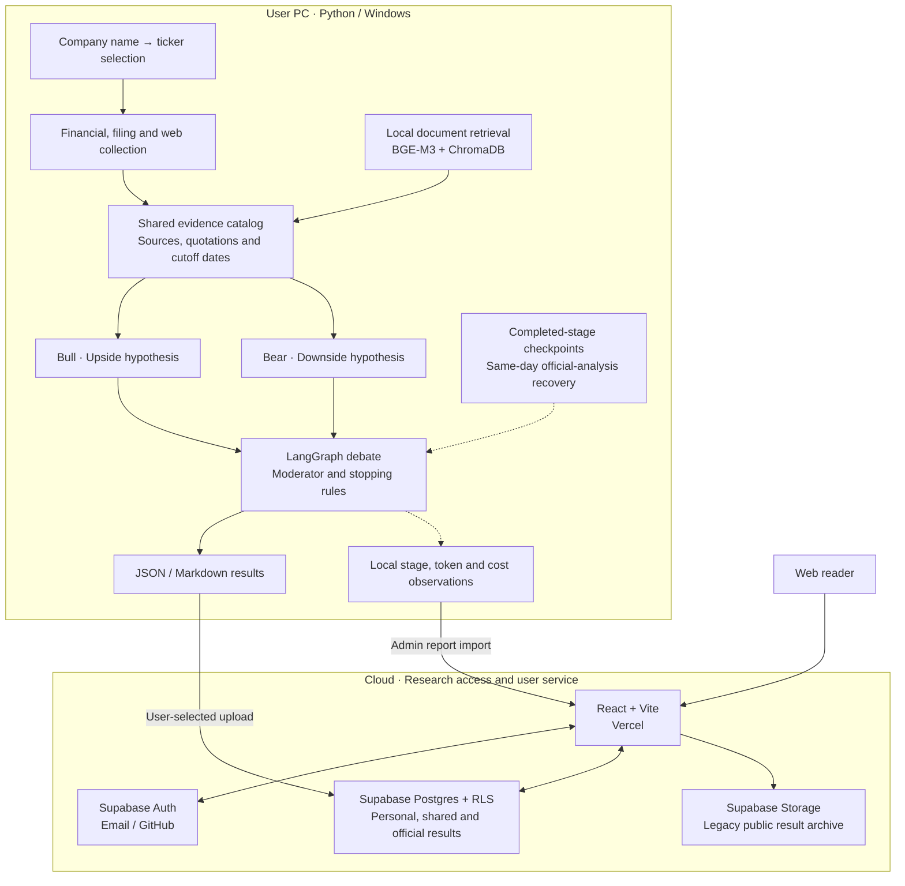

<p align="right"><a href="README.md">한국어</a> | <strong>English</strong></p>

<div align="center">

# MarketCouncil

### Shared evidence. Competing perspectives. The reasoning behind a decision.

**An evidence-based debate between Bull, Bear and Moderator agents, with a service for reading, saving and sharing the results.**

[Explore the service](https://frontend-six-pi-h5i7tztups.vercel.app/?lang=en) · [Research library](https://frontend-six-pi-h5i7tztups.vercel.app/app?lang=en) · [Windows download](https://frontend-six-pi-h5i7tztups.vercel.app/download?lang=en) · [Implementation](https://github.com/woosukkk/MarketCouncil/tree/debate_focus)

`Python 3.11` · `React 19 / Vite` · `LangGraph` · `ChromaDB / BGE-M3` · `Supabase` · `Vercel`

</div>

[](https://frontend-six-pi-h5i7tztups.vercel.app/?lang=en)

> Captured from the live service on November 3, 2026. Dates and figures in the preview belong to a saved analysis, not live market data. [Capture notes](docs/images/readme/README.md)

[Screens](#actual-service-screens) · [Features](#what-it-does) · [Architecture](#system-architecture) · [Run](#getting-started) · [Validation](#validation-and-measurement)

## Why build this?

A convincing answer from one model can hide **which evidence it relied on, what contradicts it, and what has not been established**.

MarketCouncil collects financial data, filings, research documents and web sources into shared evidence. Bull and Bear then address the same questions with competing hypotheses. Rather than declaring a winner, the Moderator records new evidence, changes in position and unresolved questions. Readers can trace a claim back to the quoted source.

**The released product combines a web research viewer with a Windows app for local analysis.** New analyses run on the user's PC with their own OpenAI key. The website provides access, personal storage and sharing for saved results.

Use **한국어 / EN** in the upper-right corner to switch the web interface. Your choice is remembered in the browser. Saved analyses, company names and source quotations stay in their original language; the switch does not run paid translation or generate an English version of an existing debate.

## Actual service screens

<table>
  <tr>
    <td width="50%"><strong>Research library</strong><br/>Browse saved analyses and dated official discussions.</td>
    <td width="50%"><strong>Debate details</strong><br/>Follow topics, rounds and open questions.</td>
  </tr>
  <tr>
    <td></td>
    <td></td>
  </tr>
</table>

These additional screenshots preserve the Korean interface and saved results captured on November 3, 2026. The English interface uses the same views and does not rewrite the underlying analysis.

<details>
<summary><strong>From a claim to its source: expanded evidence</strong></summary>

Expand a citation to see its excerpt, publication date, page and original-source link. A quotation match is distinct from verifying the truth of the investment claim or the accuracy of a forecast.


</details>

<details>
<summary><strong>Full debate view: Bull, Bear and Moderator review</strong></summary>


</details>

## What it does

| Area | Implemented behavior |
| --- | --- |
| Evidence-based debate | Selects up to three topics from shared evidence, with Bull, Bear and Moderator turns over two to three rounds. Stops when there is no new information or no open issue to pursue. |
| Evidence traceability | Links claims to source IDs and quote IDs. Preserves quotations, original-source links and numeric/date review information. |
| Research website | Library search, topic/round navigation, final summaries, sources and full analysis text. |
| User service | Email/GitHub sign-in, watchlists, analysis bookmarks, personal discussion storage, sharing links and community publication. Personal uploads are private by default. |
| Windows analysis | Looks up ticker candidates from a company name and runs analysis with the user's key. Saves JSON locally before the user chooses whether to upload it. |
| Operations and evaluation | Editor-only daily official selection, local scheduled runs and stage recovery, plus admin performance, RAG retrieval and claim–evidence quality reports. |

Select Samsung Electronics, SK hynix, Hyundai Motor, NAVER, Apple or Microsoft in Research by company to browse published results. New analyses run in the PC app. Missing filing or earnings originals block paid analysis. The local evidence check on November 5, 2026 met the minimum for four Korean companies; SEC access restrictions still block US filing preparation. Evidence availability is separate from actual debate quality. See the [evidence preparation guide](https://github.com/woosukkk/MarketCouncil/blob/debate_focus/docs/company-evidence-readiness.md).

## System architecture

**Analysis and full source storage run locally; access, authentication and sharing run in the cloud.** The website does not host a continuously running embedding model. The user's PC supplies those resources when needed.



Full PDFs and vector databases are not copied to cloud storage for each user. Uploads include selected analysis fields and cited evidence. Owners decide whether to share or publish their results; only an official editor can select a discussion for a date.

## How debate and RAG work

1. **Separate collection from analysis.** Collect financial facts and derived metrics, official filings, local research documents and web sources. Available video claims are treated as supplementary hypotheses.
2. **Provide shared evidence.** Bull and Bear use the same deduplicated evidence catalog, so differing interpretations are not presented as differing facts.
3. **Debate a testable question.** The Moderator identifies the central disagreement. Each side supplies its claim, evidence, conditions and additional evidence needed.
4. **Track issue state.** Record `OPEN`, `CONTESTED`, `RESOLVED`, `STALEMATE` and `UNKNOWN`, along with new evidence and concessions. The final summary retains both agreement and information gaps.

### Measures against hallucination

| Mechanism | What it checks | What it does not establish |
| --- | --- | --- |
| Company and cutoff filters | Restricts company mixing and future/undated sources when a cutoff is specified | That a source itself is accurate |
| Source ID and quote ID matching | Whether a quotation is linked to the supplied source material | Whether it semantically supports the claim |
| Numeric, unit and period review | Flags unsupported numbers, formatting issues and date mismatches for review | Causality or forecast accuracy just because a number occurs in the text |
| Roles and stopping rules | Distinguishes facts, expectations and hypotheses; limits repetition | Independent errors between agents using the same model |
| Separate retrieval/answer evaluation | Keeps retrieval references separate from semantic claim review | AI accuracy without human reference labels |

These mechanisms make errors easier to detect and inspect. Agreement between agents is not treated as proof.

## Engineering decisions

| Problem | Approach |
| --- | --- |
| Restarting a long analysis from the beginning | Automatic official analysis reuses only completed stages with matching inputs, date, model and code signature. At most two analysis attempts per day, including recovery. |
| Confusing a saved result with a published result | Separate local save, private upload and official selection. A publication-only failure can retry from the saved result. |
| Storage growth from per-user document copies | Keep source documents and embeddings local; upload selected results and citations. Watchlists and bookmarks store references and metadata. |
| Unclear costs and failure causes | Record stage time, observed tokens, missing usage and estimated token cost. Unknown usage on failed calls is not reported as zero. |
| Accidental publication of personal discussions | Private defaults, ownership RLS, explicit sharing/publication and editor-only official selection. |

## Technology stack

| Layer | Technology and role |
| --- | --- |
| Web | React 19, Vite, JavaScript — research and account interfaces |
| Authentication and storage | Supabase Auth, Postgres/RLS, Storage |
| Web deployment | Vercel — frontend hosting |
| Analysis | Python 3.11, OpenAI Responses API (`gpt-5-mini`), LangGraph |
| Retrieval and documents | Sentence Transformers, BAAI/bge-m3, ChromaDB, pypdf |
| External sources | yfinance, Open DART, SEC EDGAR, SearXNG, Crawl4AI, youtube-transcript-api |
| Local execution | Tkinter, PyInstaller, Docker Compose, Windows Task Scheduler |
| Validation | Python unittest, Node test runner and reference-based retrieval/evidence evaluation tools |

Streamlit remains a separate local viewer for saved results. The public web frontend is React.

## Getting started

### Read saved research

Open the [research library](https://frontend-six-pi-h5i7tztups.vercel.app/app?lang=en) to read public analyses. Sign in for personal storage, watchlists and bookmarks.

### Analyze with the Windows app

1. Download the **Windows 0.8.0** ZIP from the [download page](https://frontend-six-pi-h5i7tztups.vercel.app/download?lang=en) and extract it into a separate folder.
2. Keep `_internal` alongside `MarketCouncil.exe` and run the executable.
3. Prepare Docker Desktop, enter your own OpenAI key and a company name, then select a ticker candidate. Enter your DART key for Korean filings or a contact identifier for SEC requests, then prepare and check company evidence.
4. Save the result locally. Import its JSON through My research on the website to store it privately, then choose sharing or publication if desired.

OpenAI charges apply to the key owner. Browser resources and the document embedding model are downloaded when needed. If moving to a new executable folder, save automatic-publication settings again to update the scheduled path. The website's language switch does not change the Windows app's interface language.

### Run from source

The current implementation and these instructions refer to [`debate_focus`](https://github.com/woosukkk/MarketCouncil/tree/debate_focus), which differs from the default branch's presentation documents. Use Python 3.11 and Docker Desktop.

```powershell
git clone --branch debate_focus --single-branch https://github.com/woosukkk/MarketCouncil.git
cd MarketCouncil
python -m venv venv
venv\Scripts\python.exe -m pip install -r requirements.txt
venv\Scripts\python.exe -m playwright install chromium
Copy-Item .env.example .env
# Set your own keys and required configuration in .env, then run:
venv\Scripts\python.exe -m desktop.main
```

Main settings: `OPENAI_API_KEY`, `DART_API_KEY` for Korean filings, `SEC_USER_AGENT` for US filings and `SEARXNG_URL`. Do not commit `.env`, keys, tokens or checkpoints.

<details>
<summary>Frontend development and legacy local tools</summary>

```powershell
cd frontend
npm ci
npm run dev
```

For account features, set your project's public `VITE_SUPABASE_URL` and `VITE_SUPABASE_PUBLISHABLE_KEY` in `frontend/.env.local`, and prepare Supabase schemas, RLS and Auth settings. Never put a server secret in frontend configuration. `VITE_RESULTS_BASE_URL` optionally points to the public legacy archive.

Use **한국어 / EN** to switch interface language, or open an internal route with `?lang=en` (use `&lang=en` if it already has query parameters). The browser remembers your choice. The switch preserves existing query parameters and URL fragments.

`run_marketcouncil.bat` is the legacy local CLI; `view_debate.bat` opens the Streamlit viewer. Running the frontend alone does not start AI analysis.

</details>

## Validation and measurement

| Area | Verified scope |
| --- | --- |
| Multi-company expansion (November 3, 2026) | 126 Python and 57 web checks plus the web build passed from a clean build commit. Live company lookup and public financial-provider API checks covered SK hynix, Hyundai Motor, NAVER, Apple and Microsoft: ticker, currency, four annual periods, price and market capitalization. Actual AI debate and RAG quality were not revalidated in this change |
| Web language release (November 3, 2026) | 55 web checks and production build passed; verified live language switching, preserved sign-in state, public routes and deployed bundle. Analyses and citations retain their original language |
| Windows 0.6.0 / Web 0.12.1 release (October 29, 2026) | 129 Python and 48 web checks passed; ZIP integrity, executable initialization/synthetic instrumentation, public download and production bundle checked |
| Analysis observations | Total/stage duration, observed input/output/cache/reasoning tokens, API request/error counts and dated token-price estimates |
| RAG retrieval | A 12-question pilot checked against real documents; Recall@k, Precision@k, MRR, search latency and company/date mixing. A limited, single-company-heavy sample |
| Claim–evidence quality | Local review queue, human references versus separate predictions, and explicit human/model/unreviewed and real/synthetic origins. Without human references, semantic quality remains unevaluated |

Test counts refer to the specified release verification, not unique tests across the repository or AI accuracy. Observed cost estimates exclude internal SDK retries, tool fees, tax and account billing.

<details>
<summary>Example core regression checks using mocked APIs</summary>

```powershell
$env:OPENAI_API_KEY='offline-test-key'
$env:PYTHON_DOTENV_DISABLED='1'
venv\Scripts\python.exe -m unittest tests.test_run_observability tests.test_quality_benchmark test_analysis_recovery test_packaged_daily
cd frontend
npm test
```

These commands do not rerun a real analysis or publish an official discussion. Do not invent accuracy figures without reference datasets and human review.

</details>

## Code and documentation

| Path | Responsibility |
| --- | --- |
| [`frontend/`](https://github.com/woosukkk/MarketCouncil/tree/debate_focus/frontend) | Public web, personal, community and admin interfaces |
| [`desktop/`](https://github.com/woosukkk/MarketCouncil/tree/debate_focus/desktop) | Windows UI, account connection, official analysis and daily execution |
| [`agents/`](https://github.com/woosukkk/MarketCouncil/tree/debate_focus/agents), [`app/`](https://github.com/woosukkk/MarketCouncil/tree/debate_focus/app) | Role-specific prompts, analysis and recovery workflows |
| [`rag/`](https://github.com/woosukkk/MarketCouncil/tree/debate_focus/rag), [`tools/`](https://github.com/woosukkk/MarketCouncil/tree/debate_focus/tools) | Retrieval, evidence processing, collection, instrumentation and evaluation |
| [`supabase/`](https://github.com/woosukkk/MarketCouncil/tree/debate_focus/supabase) | Discussions, lists, editor permissions, RLS and publication validation SQL |

- [Multi-company scope and verification](https://github.com/woosukkk/MarketCouncil/blob/debate_focus/docs/multi-company-verification-2026-11-03.md)
- [Deployment versions and verification](https://github.com/woosukkk/MarketCouncil/blob/debate_focus/docs/deployment-versions.md)
- [Stage recovery and failure diagnostics](https://github.com/woosukkk/MarketCouncil/blob/debate_focus/docs/analysis-recovery.md)
- [Admin performance, RAG and evidence quality](https://github.com/woosukkk/MarketCouncil/blob/debate_focus/docs/admin-performance.md)
- [Live analysis and quality verification](https://github.com/woosukkk/MarketCouncil/blob/debate_focus/docs/live-analysis-verification-2026-10-15.md)
- [Windows distribution and user workflow](https://github.com/woosukkk/MarketCouncil/blob/debate_focus/docs/desktop-distribution.md)

Technical records linked above are primarily in Korean. This English README translates the project overview, not the entire documentation collection.

## Next steps

- [ ] Expand reference datasets across companies, sources and cutoff dates, with independent human evidence review.
- [ ] Repeat real-model RAG measurements with sufficient memory and controlled comparison conditions.
- [ ] Validate a complete fresh-PC installation, analysis and storage workflow.
- [ ] Compare previous hypotheses and their invalidation conditions with observed outcomes; add time-fixed backtesting and probability calibration.
- [ ] Evaluate correlated errors before introducing model diversity.

The debate participants currently use the same base model. Different roles alone do not make their errors independent. The project does not provide automated trading, guaranteed returns or unvalidated claims of AI accuracy.

---

**Better evidence before more agents. Testable hypotheses before stronger conviction.**
