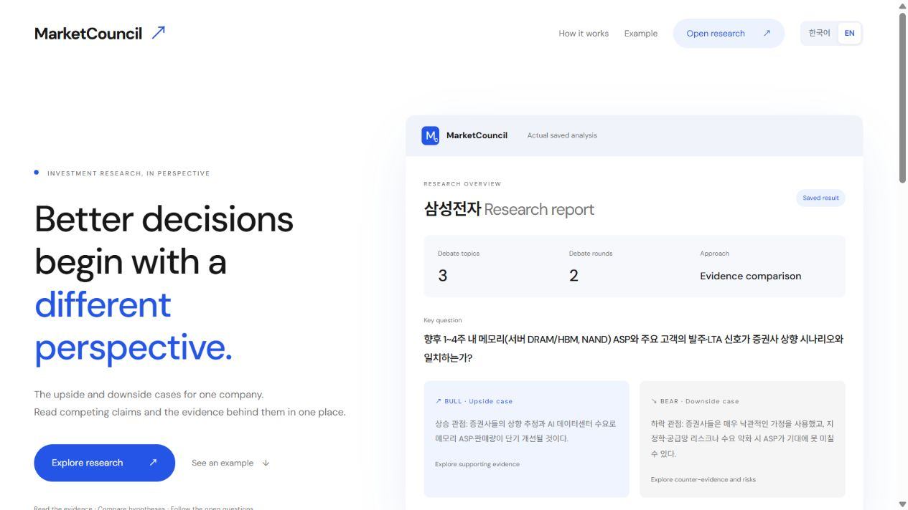
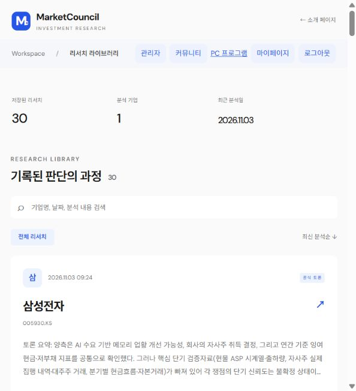
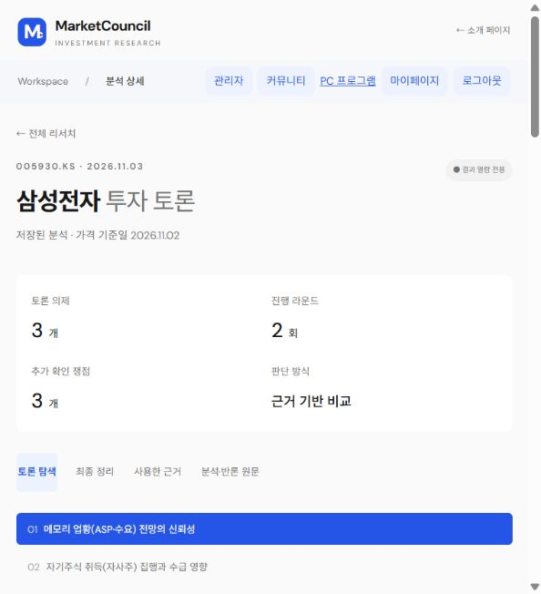
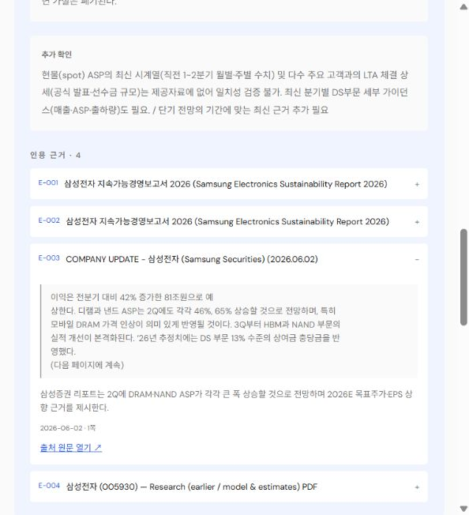

<a href="README.md">한국어</a> | <strong>English</strong>

# MarketCouncil

### Compare competing investment hypotheses against shared evidence.

Bull and Bear debate from the same sources. The Moderator records open issues and the evidence needed to resolve them.

[Website](https://frontend-six-pi-h5i7tztups.vercel.app/?lang=en) · [Research library](https://frontend-six-pi-h5i7tztups.vercel.app/app?lang=en) · [Windows download](https://frontend-six-pi-h5i7tztups.vercel.app/download?lang=en)

`React` · `Python` · `LangGraph` · `ChromaDB / BGE-M3` · `Supabase` · `Vercel`

## Why I built MarketCouncil

Two people can read the same earnings release and reach different conclusions. One might see revenue growth as a sign of stronger demand, while the other asks how much came from pricing. A single AI summary can leave out the assumptions and counterevidence behind those interpretations.

MarketCouncil started with the idea of giving both sides the same evidence and making their points of agreement and disagreement visible. I wanted readers to be able to check the original sources and decide what new information would change their judgment.

## What you can do

- Browse published research on Samsung Electronics, SK hynix, Hyundai Motor, NAVER, Apple and Microsoft.
- Compare the Bull and Bear arguments and follow each citation back to its source.
- Sign in to save companies and analyses. Personal debates start private and can be shared by link or published to the community.
- Create analyses in the Windows app and read saved results on the web. The website supports Korean and English interfaces.

| Research library | Debate detail |
| --- | --- |
|  |  |

See how a debate links to its citations and sources

## How it works

1. **Prepare evidence.** Select the company and cutoff date, then gather filings, earnings material and retrieved documents. Analysis waits if required original material is missing.
2. **Debate.** Bull proposes an upside case, Bear develops the downside case, and the Moderator records where their evidence and assumptions differ.
3. **Trace evidence.** Claims link to source records and quotations. The result preserves the scope of support, counterevidence and open questions.
4. **Store and share.** Analysis and source storage run on the user’s PC. Selected results can be stored in the cloud for private access or publication.

Retrieval quality uses questions with reference evidence. Answer grounding uses citation checks and separate evaluation. Facts, hypotheses and evidence gaps stay distinct so readers can revisit the reasoning. [Architecture and principles](docs/how-it-works.md#architecture-and-principles)

## A sample debate

Imagine a company reports higher revenue in its earnings release.

| Role | What it considers |
| --- | --- |
| Bull | If unit sales also rose, demand may have strengthened. |
| Bear | Higher prices or currency effects can also explain revenue growth. |
| Moderator | Both sides agree that revenue rose. To assess demand, compare unit sales, average selling prices, and currency effects. |

In a published debate, you can expand a citation to see what supports the claim. [Read a published debate](https://frontend-six-pi-h5i7tztups.vercel.app/app?lang=en)

## Design choices

- **Compare evidence from the same point in time.** Both sides use the same company and cutoff date. This helps readers separate disagreements about interpretation from differences in the information available at the time.
- **Record what would change the judgment.** Unresolved questions stay with the debate so readers can revisit them after a new filing or earnings release.
- **Separate analysis from reading.** The PC handles retrieval and debate generation. Once selected results are stored on the website, readers can browse and share them while the analysis app is closed.

The application source is maintained on the [`debate_focus` branch](https://github.com/woosukkk/MarketCouncil/tree/debate_focus).
