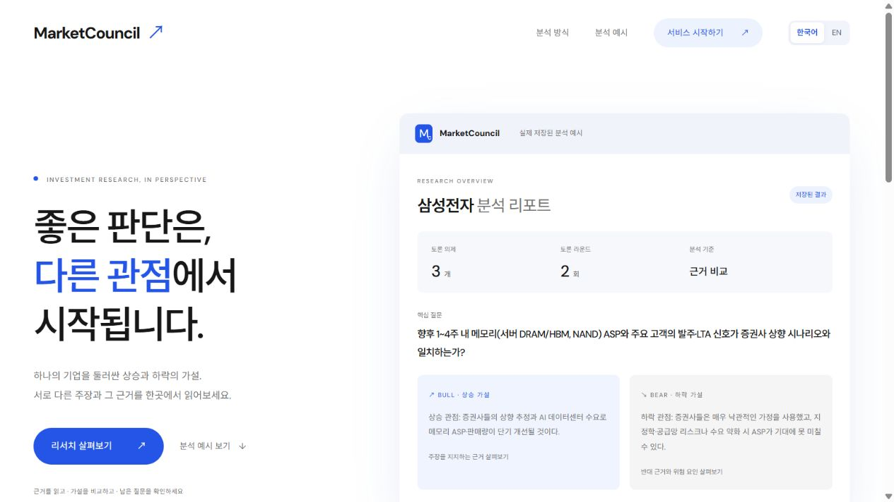
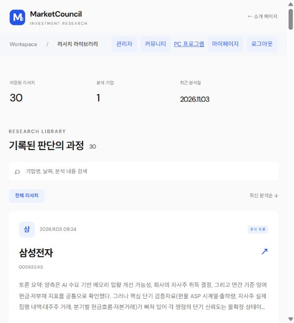
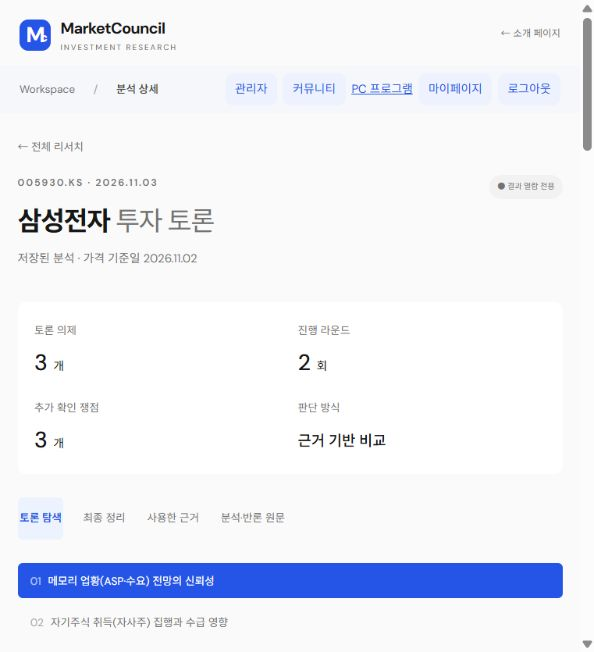
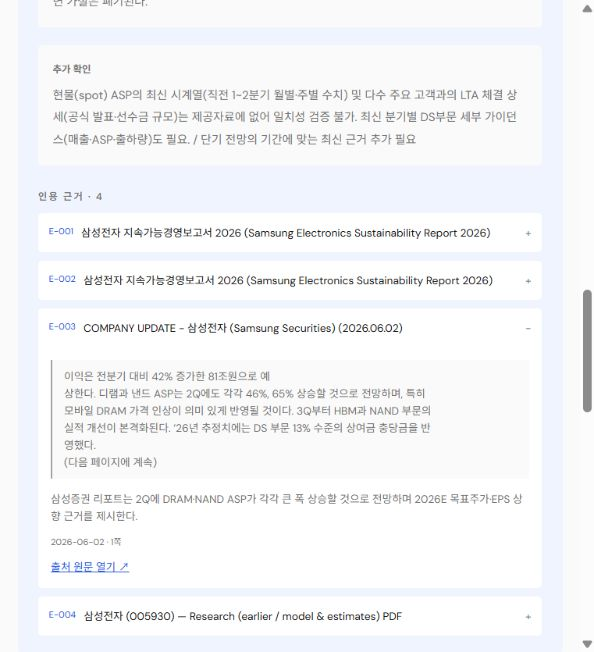
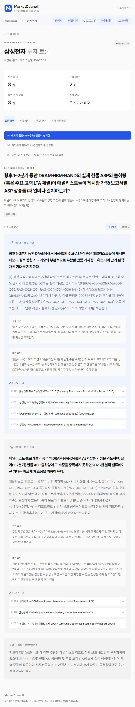
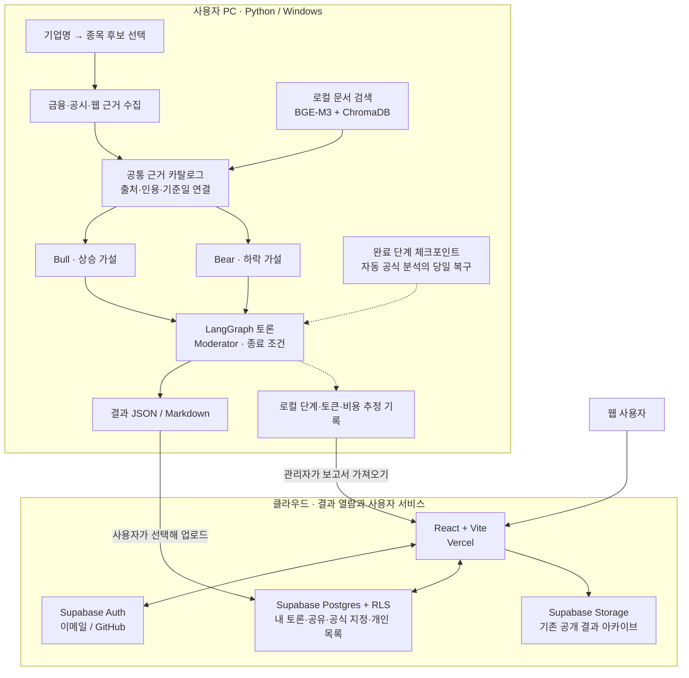

<div align="center">

# MarketCouncil

### 같은 근거, 다른 관점. 결론보다 판단의 과정을 읽는 투자 리서치.

**Bull · Bear · Moderator가 근거를 대조하는 AI 토론과, 그 기록을 읽고 보관하는 서비스입니다.**

[서비스 둘러보기](https://frontend-six-pi-h5i7tztups.vercel.app/) · [리서치 라이브러리](https://frontend-six-pi-h5i7tztups.vercel.app/app) · [Windows 다운로드](https://frontend-six-pi-h5i7tztups.vercel.app/download) · [구현 소스](https://github.com/woosukkk/MarketCouncil/tree/debate_focus)

`Python 3.11` · `React 19 / Vite` · `LangGraph` · `ChromaDB / BGE-M3` · `Supabase` · `Vercel`

</div>

[](https://frontend-six-pi-h5i7tztups.vercel.app/)

> 2026-11-03 운영 사이트를 직접 캡처했습니다. 화면 속 날짜·숫자는 저장된 분석 시점의 기록입니다. [캡처 정보](docs/images/readme/README.md)

[화면](#실제-서비스-화면) · [기능](#무엇을-할-수-있나요) · [구조](#시스템-구조) · [실행](#실행하기) · [검증](#검증과-측정-범위)

## 왜 만들었나요?

하나의 모델이 만든 그럴듯한 결론만으로는 **어떤 근거를 믿었는지, 반대 근거가 무엇인지, 무엇이 아직 확인되지 않았는지** 파악하기 어렵습니다.

MarketCouncil은 금융 데이터·공시·리서치 문서·웹 자료를 공통 근거로 모은 뒤, Bull과 Bear가 같은 쟁점에 다른 가설로 답하도록 구성했습니다. Moderator는 승자를 선언하기보다 근거의 추가·입장 변화·미해결 질문을 기록합니다. 사용자는 토론에서 원문 인용까지 따라가며 판단의 과정을 확인합니다.

**현재 공개한 형태는 웹 열람 서비스 + Windows 로컬 분석 프로그램입니다.** 새 분석은 사용자 PC와 본인 OpenAI 키로 실행하고, 웹에서는 저장된 결과를 읽고 계정에 보관·공유합니다.

## 실제 서비스 화면

<table>
  <tr>
    <td width="50%"><strong>리서치 라이브러리</strong><br/>날짜별 공식 토론과 저장된 분석을 탐색합니다.</td>
    <td width="50%"><strong>토론 상세</strong><br/>의제·라운드·남은 질문을 따라 읽습니다.</td>
  </tr>
  <tr>
    <td></td>
    <td></td>
  </tr>
</table>

<details>
<summary><strong>주장에서 인용 원문까지: 근거 확인 화면 보기</strong></summary>

인용을 펼치면 발췌문·출처 날짜·페이지와 원문 링크를 확인할 수 있습니다. 원문 연결과 인용 대조는 **투자 주장의 사실성이나 미래 전망의 정확도를 보증하는 판정과 구분**합니다.



</details>

<details>
<summary><strong>Bull/Bear 주장과 진행자 검토가 있는 토론 전체 화면 보기</strong></summary>



</details>

## 무엇을 할 수 있나요?

| 영역 | 구현한 기능 |
| --- | --- |
| 근거 기반 AI 토론 | 공통 근거에서 의제를 최대 3개 선정하고, Bull·Bear 발언과 Moderator 검토를 2~3라운드로 진행합니다. 새 정보와 열린 쟁점이 없으면 종료합니다. |
| 근거 추적 | source ID·quote ID로 주장과 인용을 연결합니다. 인용문·원문 링크·수치 및 시점 검토 항목을 결과에 보존합니다. |
| 리서치 웹 | 라이브러리 검색, 의제·라운드별 탐색, 최종 정리, 사용한 근거와 분석 원문을 제공합니다. |
| 사용자 서비스 | 이메일·GitHub 로그인, 관심기업, 분석 북마크, 내 토론 보관, 링크 공유와 커뮤니티 게시를 지원합니다. 업로드한 개인 토론은 기본 비공개입니다. |
| Windows 분석 | 기업명으로 종목 후보를 찾고 본인 키로 분석합니다. JSON을 로컬에 저장한 뒤 원하는 결과만 업로드할 수 있습니다. |
| 운영·평가 | 운영자의 하루 1개 공식 지정, 로컬 예약 실행·단계 복구, 관리자 성능 기록과 RAG 검색/답변 근거 품질 평가를 제공합니다. |

삼성전자 공식 토론을 운영 사례로 사용합니다. 기업명 조회가 가능하더라도 기업·자료원별 데이터 제공 범위가 같지는 않으며, 관심기업 추가만으로 새 분석이 실행되지는 않습니다.

## 시스템 구조

**분석 계산과 원문 보관은 로컬에, 열람·인증·공유는 클라우드에 배치했습니다.** 웹 서버에 임베딩 모델을 상시 올려두는 대신 사용자가 분석할 때 PC 자원을 사용합니다.



PDF 원문과 벡터 DB를 사용자마다 클라우드에 복제하지 않습니다. 결과 업로드는 선택된 분석 필드와 인용 근거를 전송하며, 공개·공유 여부는 결과의 소유자가 선택합니다. 운영자만 날짜별 공식 토론을 지정할 수 있습니다.

## 토론과 RAG는 어떻게 동작하나요?

1. **수집과 분석을 분리합니다.** 금융 사실·파생 지표, 공식 공시, 로컬 리서치 문서, 웹 자료를 수집합니다. 이용 가능한 영상 주장은 보조 가설로 취급합니다.
2. **같은 근거를 제공합니다.** 중복을 정리한 evidence catalog를 Bull과 Bear가 함께 사용합니다. 서로 다른 해석을 사실의 차이로 포장하지 않도록 합니다.
3. **검증 질문으로 토론합니다.** Moderator가 핵심 충돌을 의제로 만들고, 양측은 주장·근거·성립 조건·추가 확인 사항을 제시합니다.
4. **쟁점 상태를 갱신합니다.** `OPEN`, `CONTESTED`, `RESOLVED`, `STALEMATE`, `UNKNOWN` 상태와 새 근거·인정 사항을 기록합니다. 최종 정리는 합의와 데이터 공백을 함께 남깁니다.

### 할루시네이션을 줄이기 위한 장치

| 장치 | 확인하는 것 | 보장하지 않는 것 |
| --- | --- | --- |
| 기업·기준일 필터 | 기준일을 지정한 검색에서 기업 혼입과 미래·날짜 미상 자료 유입을 제한 | 수집된 원문의 사실성 |
| source ID · quote ID 대조 | 제공한 자료의 인용인지, 저장한 원문 인용과 연결되는지 | 인용이 주장을 의미상 뒷받침하는지 |
| 수치·단위·기간 검토 | 인용에 없는 수치, 표기 문제와 시점 불일치를 재검토 대상으로 표시 | 숫자가 보인다는 이유만으로 인과·전망을 정답으로 판정 |
| 역할·종료 조건 | 사실·기대·가설을 구분하고 반복 토론을 제한 | 같은 모델이 공유하는 편향의 완전한 제거 |
| 검색/답변 평가 분리 | 검색 정답과 답변 의미 검수를 서로 다른 보고서로 관리 | 사람 정답이 없는 경우의 AI 정확도 |

이 장치들은 오류를 찾아내고 검토할 수 있게 만드는 구조입니다. 여러 에이전트가 동의했다고 사실로 확정하지 않습니다.

## 운영에서 다룬 문제

| 문제 | 적용한 방식 |
| --- | --- |
| 장시간 분석이 중단되면 처음부터 다시 실행 | 자동 공식 분석은 입력·날짜·모델·코드 서명을 확인한 완료 단계만 재사용합니다. 같은 날 분석 시도는 복구를 포함해 최대 2회입니다. |
| 분석 저장 성공과 공개 게시 성공이 혼동됨 | 로컬 저장 → 비공개 업로드 → 공식 지정 단계를 분리합니다. 게시만 실패하면 저장한 결과로 재시도합니다. |
| 사용자별 자료 복제로 인한 저장 공간 증가 | 원문·임베딩은 로컬에 두고 결과와 선택 인용만 전송합니다. 관심기업·북마크는 참조와 메타데이터를 저장합니다. |
| 비용과 실패 원인을 알기 어려움 | 단계별 시간·관측 API 토큰·누락 사용량·추정 비용을 기록합니다. 사용량을 모르는 실패를 0원으로 만들지 않습니다. |
| 개인 토론의 의도하지 않은 공개 | 기본 비공개와 사용자 소유권 RLS, 명시적 공유/게시, 운영자 공식 지정 경로를 구분합니다. |

## 기술 스택

| 계층 | 사용 기술과 역할 |
| --- | --- |
| 웹 | React 19, Vite, JavaScript — 리서치 열람·사용자 화면 |
| 인증·결과 보관 | Supabase Auth, Postgres/RLS, Storage |
| 웹 배포 | Vercel — 프런트엔드 배포 |
| 분석 | Python 3.11, OpenAI Responses API (`gpt-5-mini`), LangGraph |
| 검색·문서 | Sentence Transformers, BAAI/bge-m3, ChromaDB, pypdf |
| 외부 자료 | yfinance, Open DART, SEC EDGAR, SearXNG, Crawl4AI, youtube-transcript-api |
| 로컬 실행 | Tkinter, PyInstaller, Docker Compose, Windows 작업 스케줄러 |
| 검증 | Python unittest, Node test runner, 정답 기반 검색/근거 평가 도구 |

Streamlit은 소스에서 저장 결과를 확인하는 별도 로컬 뷰어로 남아 있습니다. 공개 웹의 프런트엔드는 React입니다.

## 실행하기

### 웹에서 결과 열람

[리서치 라이브러리](https://frontend-six-pi-h5i7tztups.vercel.app/app)에서 공개된 분석을 읽을 수 있습니다. 개인 보관·관심기업·북마크는 로그인 후 이용합니다.

### Windows 프로그램으로 분석

1. [다운로드 페이지](https://frontend-six-pi-h5i7tztups.vercel.app/download)에서 **Windows 0.6.0** ZIP을 받아 별도 폴더에 풉니다.
2. `_internal` 폴더를 유지하고 `MarketCouncil.exe`를 실행합니다.
3. Docker Desktop을 준비하고, 본인 OpenAI 키와 기업명을 입력한 뒤 종목 후보를 선택합니다. Open DART 키는 한국 공시 수집에 선택적으로 사용합니다.
4. 분석 결과를 로컬에 저장합니다. 웹 마이페이지에서 JSON을 가져와 비공개로 보관한 뒤 공유·게시를 선택할 수 있습니다.

OpenAI 사용료는 키 소유자에게 발생합니다. 처음 사용하는 브라우저·문서 임베딩 모델은 필요할 때 내려받습니다. 다른 폴더의 새 EXE로 자동 게시를 이용하려면 설정을 다시 저장해 예약 경로를 갱신합니다.

### 소스에서 실행

현재 구현·실행 안내의 기준 브랜치는 [`debate_focus`](https://github.com/woosukkk/MarketCouncil/tree/debate_focus)입니다. 기본 브랜치의 소개 문서와 구분해 아래 명령으로 받습니다. Python 3.11과 Docker Desktop이 필요합니다.

```powershell
git clone --branch debate_focus --single-branch https://github.com/woosukkk/MarketCouncil.git
cd MarketCouncil
python -m venv venv
venv\Scripts\python.exe -m pip install -r requirements.txt
venv\Scripts\python.exe -m playwright install chromium
Copy-Item .env.example .env
# .env에 본인 키와 필요한 설정을 입력한 뒤 실행
venv\Scripts\python.exe -m desktop.main
```

로컬 분석의 주요 설정은 `OPENAI_API_KEY`, 선택적 `DART_API_KEY`, `SEC_USER_AGENT`, `SEARXNG_URL`입니다. `.env`·키·토큰·체크포인트를 커밋하지 않습니다.

<details>
<summary>웹 프런트엔드 개발 및 기존 CLI·뷰어</summary>

```powershell
cd frontend
npm ci
npm run dev
```

계정 기능은 `frontend/.env.local`에 본인 프로젝트의 공개 연결 값 `VITE_SUPABASE_URL`, `VITE_SUPABASE_PUBLISHABLE_KEY`를 설정하고 Supabase 스키마·Auth를 준비해야 합니다. 서버 secret 키는 프런트엔드에 넣지 않습니다. 공개 결과 아카이브 주소는 선택적으로 `VITE_RESULTS_BASE_URL`로 지정합니다.

기존 로컬 CLI는 `run_marketcouncil.bat`, 저장 결과용 Streamlit 뷰어는 `view_debate.bat`입니다. 웹 개발 설정만으로 새 AI 분석이 실행되지는 않습니다.

</details>

## 검증과 측정 범위

| 구분 | 확인한 범위 |
| --- | --- |
| Windows 0.6.0 · Web 0.12.1 배포 검증 (2026-10-29) | Python 129개·웹 48개 검사 통과, ZIP 무결성·실제 EXE 초기화와 합성 계측·공개 다운로드·운영 웹 번들 확인 |
| 분석 관측 | 전체·단계별 시간, 관측 입력/출력/캐시/추론 토큰, API 단계별 요청·오류와 날짜별 단가의 토큰 비용 추정 |
| RAG 검색 | 실제 문서를 대조한 12문항 파일럿과 Recall@k·Precision@k·MRR·검색 지연·기업/시점 혼입 지표. 단일 기업 중심의 제한된 표본 |
| 답변 근거 품질 | 주장·인용 로컬 검토 큐, 사람 정답과 별도 예측 비교, 미검수/모델/사람·실제/합성 출처 구분. 사람 정답이 없으면 의미 판정은 미평가 |

검사 수는 해당 배포의 검증 기록이며 저장소 전체 고유 테스트 수나 AI 정확도가 아닙니다. 관측 비용은 SDK 내부 재시도·도구 요금·세금·계정 청구서를 포함하지 않습니다.

<details>
<summary>모의 API를 사용하는 핵심 회귀 검사 예시</summary>

```powershell
$env:OPENAI_API_KEY='offline-test-key'
$env:PYTHON_DOTENV_DISABLED='1'
venv\Scripts\python.exe -m unittest tests.test_run_observability tests.test_quality_benchmark test_analysis_recovery test_packaged_daily
cd frontend
npm test
```

실제 분석과 공식 게시를 재실행하는 명령은 아닙니다. 정답 데이터셋·사람 검토 결과가 없는 상태에서 임의의 정확도를 만들지 않습니다.

</details>

## 코드와 문서 찾아보기

| 경로 | 역할 |
| --- | --- |
| [`frontend/`](https://github.com/woosukkk/MarketCouncil/tree/debate_focus/frontend) | 공개 웹·마이페이지·커뮤니티·관리자 화면 |
| [`desktop/`](https://github.com/woosukkk/MarketCouncil/tree/debate_focus/desktop) | Windows UI·계정 연결·공식 분석·일일 실행 |
| [`agents/`](https://github.com/woosukkk/MarketCouncil/tree/debate_focus/agents), [`app/`](https://github.com/woosukkk/MarketCouncil/tree/debate_focus/app) | 역할별 프롬프트·분석 및 복구 워크플로 |
| [`rag/`](https://github.com/woosukkk/MarketCouncil/tree/debate_focus/rag), [`tools/`](https://github.com/woosukkk/MarketCouncil/tree/debate_focus/tools) | 문서 검색·근거 처리·수집·계측·평가 |
| [`supabase/`](https://github.com/woosukkk/MarketCouncil/tree/debate_focus/supabase) | 토론·목록·운영자·RLS·게시 검증 SQL |

- [배포 검증과 버전 기록](https://github.com/woosukkk/MarketCouncil/blob/debate_focus/docs/deployment-versions.md)
- [로컬 단계 복구와 오류 진단](https://github.com/woosukkk/MarketCouncil/blob/debate_focus/docs/analysis-recovery.md)
- [관리자 성능·RAG·근거 품질 평가](https://github.com/woosukkk/MarketCouncil/blob/debate_focus/docs/admin-performance.md)
- [실제 분석·품질 검증 기록](https://github.com/woosukkk/MarketCouncil/blob/debate_focus/docs/live-analysis-verification-2026-10-15.md)
- [Windows 배포와 사용 흐름](https://github.com/woosukkk/MarketCouncil/blob/debate_focus/docs/desktop-distribution.md)

## 남은 과제

- [ ] 기업·자료원·기준일을 확장한 정답 데이터셋과 독립적인 사람 근거 검수
- [ ] 충분한 메모리를 확보한 RAG 실모델 재측정 및 조건을 고정한 반복 비교
- [ ] 별도 PC의 설치부터 분석·보관까지 전체 사용자 흐름 검증
- [ ] 이전 가설·강화/폐기 조건과 실제 결과 비교, 시점 고정 백테스트·확률 보정
- [ ] 같은 모델의 상관된 오류를 검증한 뒤 필요할 때 모델 다양화 검토

현재 토론자의 기본 모델은 동일하므로 역할 분리만으로 오류가 독립적이 되지는 않습니다. 자동매매·수익률 보장·검증되지 않은 AI 정확도는 제공하지 않습니다.

---

**더 많은 에이전트보다 더 나은 근거를, 더 강한 확신보다 반증 가능한 가설을 우선합니다.**
