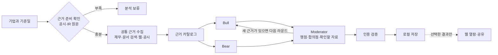

<p align="right"><strong>한국어</strong> | <a href="README.en.md">English</a></p>

<div align="center">

# MarketCouncil

### 같은 근거를 두고, 서로 다른 투자 가설을 비교합니다.

Bull과 Bear가 같은 자료로 토론하고, Moderator가 쟁점과 추가로 확인할 근거를 정리합니다.<br>
매수·매도 신호를 내지 않습니다. 판단이 어디서 갈리는지, 무엇을 더 확인해야 하는지를 보여줍니다.

[서비스](https://frontend-six-pi-h5i7tztups.vercel.app/) · [리서치 라이브러리](https://frontend-six-pi-h5i7tztups.vercel.app/app) · [Windows 다운로드](https://frontend-six-pi-h5i7tztups.vercel.app/download) · [동작 원리](docs/how-it-works.md) · [로드맵](docs/ROADMAP.md)

[](https://github.com/woosukkk/MarketCouncil/actions/workflows/ci.yml)

`Python` · `LangGraph` · `ChromaDB / BGE-M3` · `SearXNG` · `React` · `Supabase` · `Vercel`

</div>

[](https://frontend-six-pi-h5i7tztups.vercel.app/)

## 목차

[만들게 된 계기](#만들게-된-계기) · [무엇이 다른가요?](#무엇이-다른가요) · [무엇을 할 수 있나요?](#무엇을-할-수-있나요) · [어떤 원리로 동작하나요?](#어떤-원리로-동작하나요) · [토론 예시](#토론-예시) · [만들면서 바뀐 생각](#만들면서-바뀐-생각) · [아직 하지 못하는 것](#아직-하지-못하는-것) · [직접 실행하기](#직접-실행하기) · [저장소 구조](#저장소-구조)

## 만들게 된 계기

같은 실적 발표를 읽고도 결론은 달라질 수 있습니다. 매출이 늘었다는 사실을 두고 한쪽은 수요가 커졌다고 보고, 다른 쪽은 가격 효과가 컸을 가능성을 따져봅니다. AI 답변 하나로 요약하면 두 해석을 가르는 가정과 반대 근거가 드러나지 않을 때가 있습니다.

MarketCouncil은 두 관점에 같은 자료를 주면 무엇에 동의하고 어디서 판단이 갈리는지 더 잘 살펴볼 수 있겠다는 생각에서 시작했습니다. 토론을 읽는 사람이 결론을 받아들이기 전에 원문을 확인하고, 어떤 자료가 나오면 판단을 바꿀지 스스로 정할 수 있게 만들고 싶었습니다.

## 무엇이 다른가요?

| | AI 답변 하나로 요약 | 매매 신호를 내는 에이전트 | MarketCouncil |
| --- | --- | --- | --- |
| 결과물 | 하나의 결론 | 매수·매도·보유 판단 | 쟁점, 합의점, 추가로 확인할 자료 |
| 근거의 범위 | 답변마다 다름 | 역할마다 따로 수집 | 양측이 **같은 근거 카탈로그**만 사용 |
| 시점 | 섞일 수 있음 | 구현에 따라 다름 | 기업과 **기준일**로 제한, 이후 자료 제외 |
| 인용 | 모델이 쓴 문장 그대로 | 요약 중심 | 저장된 원문과 대조하고, 카탈로그에 없으면 제외 |
| 자료가 부족할 때 | 그럴듯하게 채움 | 그대로 진행 | 분석을 시작하지 않거나 `확인 불가`로 남김 |

핵심은 네 가지입니다.

- **같은 근거, 다른 해석.** Bull과 Bear는 각자 검색하지 않습니다. 먼저 공통 근거를 모아 카탈로그로 만들고, 두 관점이 그 안에서만 주장합니다. 그래서 의견 차이가 "다른 자료를 읽어서"가 아니라 "같은 자료를 다르게 해석해서" 생겼다는 것을 확인할 수 있습니다.
- **기준일을 지킵니다.** 분석 기준일 이후에 나온 자료와 다른 기업의 자료는 검색 단계에서 걸러냅니다. 날짜가 불명확한 자료는 `날짜 미상`으로 둡니다.
- **인용을 검증합니다.** 카탈로그에 없는 인용은 유효 근거에서 빼고, 유효한 인용은 모델이 쓴 문장이 아니라 저장된 원문으로 복원합니다. 제목 목록, 검색 요약, 오류 페이지는 원문 근거로 인정하지 않습니다.
- **모르면 모른다고 씁니다.** 공시·IR 원문이 최소 기준에 못 미치면 유료 모델을 호출하기 전에 분석을 멈춥니다. 확인되지 않은 값은 추정하지 않고 `확인 불가` 또는 `추가 데이터 필요`로 남깁니다.

## 무엇을 할 수 있나요?

- 리서치 라이브러리에서 삼성전자, SK하이닉스, 현대자동차, NAVER, Apple, Microsoft의 공개 분석을 찾아 읽습니다.
- 토론의 쟁점과 Bull·Bear 발언을 비교하고, 각 주장에 연결된 인용과 원문을 확인합니다.
- 로그인하면 관심기업과 분석을 저장할 수 있습니다. 개인 토론은 비공개로 보관되며, 선택한 결과만 링크로 공유하거나 커뮤니티에 게시합니다.
- Windows 앱에서 새 분석을 만듭니다. 공개 웹에서는 저장된 결과를 읽고 비교하며, 화면 언어는 한국어와 영어 중 선택할 수 있습니다.

| 리서치 라이브러리 | 토론 상세 |
| --- | --- |
|  |  |

<details>
<summary>토론에서 인용과 원문을 확인하는 화면</summary>


</details>

## 어떤 원리로 동작하나요?



1. **근거 준비** — 종목과 분석 기준일을 정하고, 공시·실적 자료와 검색된 문서를 공통 근거로 모읍니다. 최소 원문이 부족하면 분석을 보류합니다.
2. **토론** — Bull은 상승 가설을, Bear는 하락 가설을 제시합니다. Moderator는 서로 다른 주장이 어떤 자료와 조건에 기대는지 정리합니다. 의제는 최대 3개이고, 새로운 근거나 실질적인 변화가 없으면 토론을 끝냅니다.
3. **근거 추적** — 주장에 출처와 인용을 연결합니다. 인용이 뒷받침하는 범위, 반대 근거, 추가 확인 항목을 결과에 남깁니다.
4. **보관과 열람** — 분석과 원문 보관은 사용자 PC에서 처리합니다. 공유할 결과만 클라우드에 저장하고, 웹에서 공식·공개 토론을 열람합니다.

| 영역 | 구성 |
| --- | --- |
| 분석 엔진 (사용자 Windows PC) | Python, LangGraph 토론 그래프, OpenAI 모델, BGE-M3 임베딩 + ChromaDB, SearXNG 검색 |
| 자료 출처 | DART·SEC 공시, 발행사 IR 원문, 재무 데이터, 웹 문서 |
| 웹 (열람·보관·공유) | React 19 + Vite, Vercel |
| 인증·저장 | Supabase (행 수준 보안으로 공개 범위 적용) |

클라우드에는 결과와 인용 발췌만 올라갑니다. PDF, 기사 본문, 검색 문맥, 임베딩은 PC에만 남습니다. 자세한 내용은 [동작 원리와 설계](docs/how-it-works.md)에 있습니다.

## 토론 예시

가상의 기업이 실적 발표에서 매출이 늘었다고 보고했다고 가정합니다.

| 역할 | 살펴보는 내용 |
| --- | --- |
| Bull | 판매량도 늘었다면 수요가 확대됐을 가능성이 있습니다. |
| Bear | 가격 인상이나 환율만으로도 매출은 늘 수 있습니다. |
| Moderator | 양쪽이 동의한 사실은 매출 증가입니다. 수요가 늘었는지는 판매량, 평균 판매 가격, 환율 효과를 대조해야 판단할 수 있습니다. |

실제 화면에서는 발언에 달린 인용을 펼쳐 어떤 자료가 주장을 뒷받침하는지 확인할 수 있습니다. [공개 토론 읽기](https://frontend-six-pi-h5i7tztups.vercel.app/app)

## 만들면서 바뀐 생각

처음에는 "두 에이전트가 토론하면 더 나은 답이 나온다"고 기대했습니다. 만들어 보니 문제는 토론보다 **근거** 쪽에 있었습니다.

- **인용이 있다고 사실인 것은 아니었습니다.** 모델은 출처를 붙이면서도 원문에 없는 문장을 쓸 수 있었습니다. 그래서 인용을 저장된 원문과 대조하고, 일치하지 않으면 근거에서 빼도록 바꿨습니다.
- **"공식 자료"라는 표시를 믿을 수 없었습니다.** 공식 자료를 찾으려고 검색했다는 이유로 일반 기사가 공식 자료로 표시된 적이 있습니다. 지금은 검색 의도와 실제로 확인된 출처 유형을 분리하고, 확인되지 않으면 `유형 미상`으로 둡니다.
- **자료가 없으면 시작하지 않는 편이 낫습니다.** 원문이 부족한 상태에서 토론을 돌리면 그럴듯하지만 근거가 약한 결과가 나왔습니다. 그래서 분석 전에 기업별 원문 준비 상태를 확인하는 단계를 넣었습니다.
- **분석과 열람은 따로 두는 것이 맞았습니다.** 문서 검색과 토론 생성은 PC에서 하고, 웹은 저장된 결과를 읽는 역할만 맡습니다. 분석 프로그램을 계속 켜 두지 않아도 결과를 읽고 공유할 수 있습니다.

## 아직 하지 못하는 것

- **주장의 사실성을 보증하지 않습니다.** 인용이 원문에 있는지는 확인하지만, 그 인용이 주장을 논리적으로 뒷받침하는지에 대한 자동 판정은 아직 없습니다.
- **정확도 수치를 제시하지 않습니다.** 검색·답변 평가 도구는 있지만, 사람이 정답을 정한 평가 데이터셋을 만드는 중이라 기준 점수가 없습니다.
- **대상 기업은 6곳입니다.** 미국 기업은 SEC 접근이 제한될 때 발행사 공식 사본으로 대체하며, 자료가 부족하면 분석이 보류될 수 있습니다.
- **새 분석은 Windows 앱에서만 만들 수 있습니다.** 사용자의 OpenAI API 키가 필요하고 호출 비용이 발생합니다.

진행 상황과 다음 계획은 [로드맵](docs/ROADMAP.md)에서 관리합니다.

## 직접 실행하기

결과를 읽기만 한다면 설치할 필요가 없습니다. [리서치 라이브러리](https://frontend-six-pi-h5i7tztups.vercel.app/app)에서 바로 볼 수 있고, 새 분석은 [Windows 앱](https://frontend-six-pi-h5i7tztups.vercel.app/download)으로 만들 수 있습니다.

소스에서 실행하려면 Windows, Python 3.11, Node 22, Docker(SearXNG용)가 필요합니다.

```powershell
git clone -b debate_focus https://github.com/woosukkk/MarketCouncil.git
cd MarketCouncil
python -m venv venv
venv\Scripts\python.exe -m pip install -r requirements\base.txt -c requirements\lock-windows.txt
copy config\.env.example config\.env   # OPENAI_API_KEY, DART_API_KEY 등을 채웁니다
```

```powershell
# 테스트 (모의 응답과 더미 키만 사용, 비용 없음)
venv\Scripts\python.exe -B -m tests

# 웹
cd frontend; npm ci; npm test; npm run dev

# 근거 준비 점검 (공개 원문 수집만, AI 호출 없음)
venv\Scripts\python.exe -m app.prepare_company_evidence --refresh --output evidence-readiness.json

# 분석 실행 (OpenAI 호출 비용 발생)
venv\Scripts\python.exe -m app.debate_main
```

## 저장소 구조

| 경로 | 역할 |
| --- | --- |
| `agents/` | Bull·Bear·Moderator 에이전트와 프롬프트, LangGraph 토론 그래프 |
| `app/` | 분석 파이프라인, 근거 준비 확인, CLI 진입점 |
| `tools/` | 공시·IR 수집기, 근거 카탈로그, 인용 검증, 실행 측정 |
| `rag/` | 문서 청킹·색인·검색 (기업·기준일 필터) |
| `desktop/` | Windows 앱과 결과 업로드 |
| `frontend/` | React 웹 (열람·보관·공유) |
| `supabase/` | 스키마, 행 수준 보안 정책, RPC |
| `tests/`, `docs/` | 테스트와 설계·검증·배포 기록 |

더 읽을 문서: [동작 원리](docs/how-it-works.md) · [평가 방법](docs/standard-evaluation.md) · [평가셋 만들기](docs/evaluation-dataset.md) · [기업별 근거 준비](docs/company-evidence-readiness.md) · [배포 버전](docs/deployment-versions.md)

서비스 구현은 [`debate_focus` 브랜치](https://github.com/woosukkk/MarketCouncil/tree/debate_focus)에서 관리합니다.

---

MarketCouncil은 투자 판단을 돕기 위한 리서치 도구이며 투자 권유나 자문이 아닙니다. 결과에는 오류가 있을 수 있으므로 원문을 직접 확인하시기 바랍니다. 투자 결정과 그 결과에 대한 책임은 이용자에게 있습니다.
