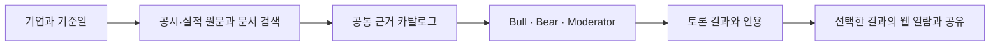

# MarketCouncil 동작 원리

[English ↓](#architecture-and-principles)

기업 식별자와 기준일로 자료의 범위를 정합니다. 원문과 발표 시점을 확인하고, 문서 검색에서는 다른 기업이나 기준일 이후 자료가 섞이지 않도록 범위를 제한합니다. 최소 근거 조건은 분석을 시작할 수 있는 자료 준비 기준입니다.

Bull과 Bear는 같은 근거 카탈로그에서 각자의 가설과 반대 근거를 구성합니다. Moderator는 남은 쟁점과 판단을 바꿀 조건을 기록합니다. 주장·출처·인용을 연결해 독자가 근거를 확인할 수 있게 하고, 확인되지 않은 내용은 추가 확인 항목으로 남깁니다.

로컬 PC는 문서 검색, 토론 생성, 원문 보관을 담당합니다. React 웹은 공개 토론과 계정별 결과를 보여줍니다. Supabase에서 인증과 저장 권한을 적용하며, 이용자가 선택한 결과에 공개 또는 공유 권한을 부여합니다.

검색은 정답 근거가 지정된 질문으로 Recall@k·Precision@k·MRR을 비교합니다. 답변은 인용의 직접 뒷받침과 참조 답변의 일치 정도를 별도로 평가합니다. 데이터셋·버전·판정 방법이 같은 결과를 비교하고, 평가 표본과 적용 범위를 함께 표시합니다.

## Architecture and principles

Evidence is scoped by company identifier and cutoff date. The system checks the original filings and earnings material before analysis, and restricts retrieval to the target company and time window. Evidence readiness describes whether the source material is sufficient to start.

Bull and Bear build competing hypotheses from a shared evidence catalog. The Moderator records unresolved questions and conditions that could change the judgment. Claims link to sources and quotations for inspection. Gaps stay visible as questions for follow-up.

The user’s PC handles retrieval, debate generation and source storage. The React website presents public and account-specific results. Supabase applies authentication and storage permissions, and users choose which personal results to share or publish.

Retrieval is evaluated against labeled evidence with Recall@k, Precision@k and MRR. Citation support and agreement with reference answers are evaluated separately. Comparisons retain the dataset, version and evaluation method alongside the measured scope.
